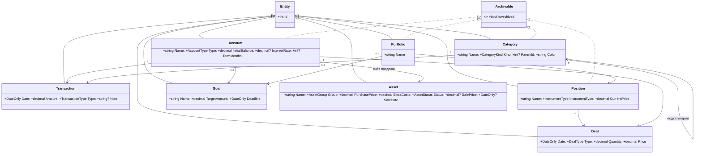
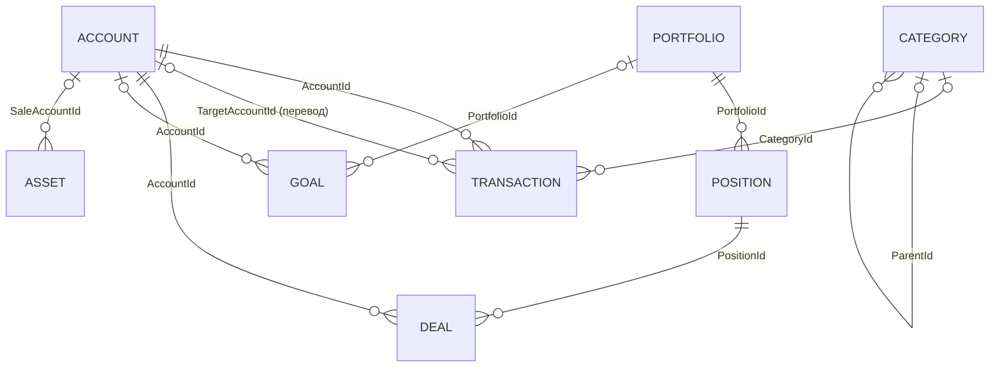

# Модель предметной области

Диаграммы описывают сущности слоя `FinTrack.Domain` (8 классов, 7 перечислений). Баланс счёта и количество по позиции в сущностях не хранятся: они вычисляются из операций и сделок.

## Диаграмма классов

## ER-диаграмма

## Перечисления

| Перечисление | Значения |
|---|---|
| `AccountType` | Debit, Savings, Deposit |
| `CategoryKind` | Income, Expense |
| `TransactionType` | Income, Expense, Transfer |
| `InstrumentType` | Stock, Bond, Crypto, PreciousMetal |
| `DealType` | Buy, Sell |
| `AssetGroup` | Electronics, Car, RealEstate, Other |
| `AssetStatus` | InStock, ForSale, Sold |
