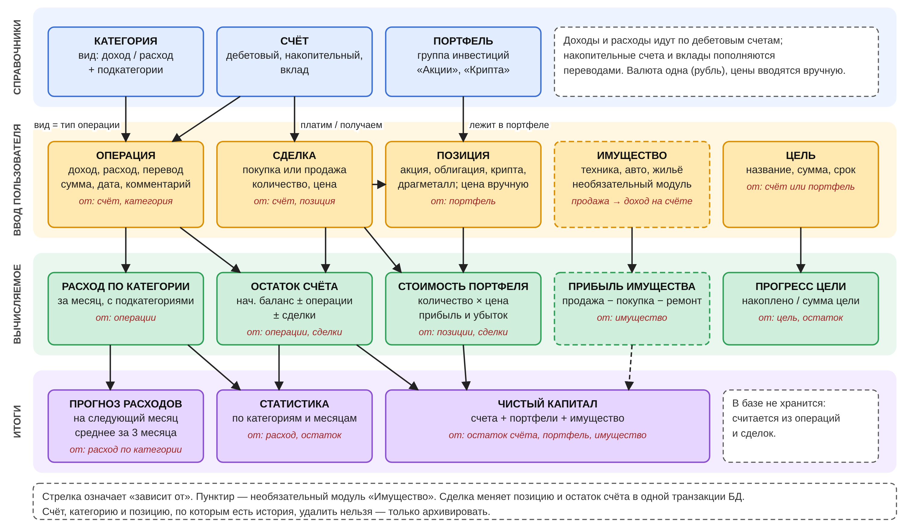
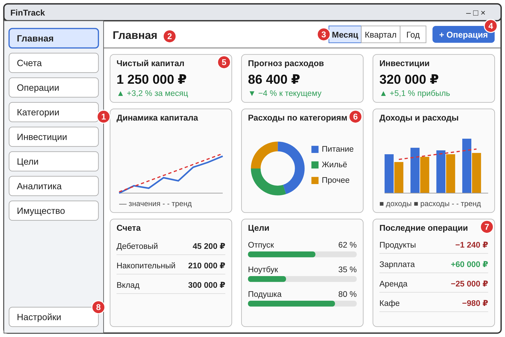

# 1. Общие сведения

|                           |                                          |
|---------------------------|------------------------------------------|
| Наименование программы    | «FinTrack» — менеджер личных финансов    |
| Разработчик (ФИО, группа) | Бланк А. В., Жовнир А. А., группа 2407г1 |
| Руководитель              | Банников В. С.                           |
| Дисциплина                | Разработка программных модулей           |
| Семестр                   | 5                                        |

# 2. Основания для разработки

Документ-основание — учебный план дисциплины «Разработка программных модулей». Тема утверждена 26.09.2026. Наименование темы курсовой работы — «FinTrack — менеджер личных финансов».

# 3. Назначение разработки

Функциональное назначение — автоматизация учёта личных финансов: ведение денежных счетов разных типов (дебетовых, накопительных, вкладов), учёт доходов и расходов по категориям, учёт инвестиций (акции, облигации, криптовалюта, драгоценные металлы), учёт имущества, приобретённого для перепродажи, постановка финансовых целей и контроль их достижения, анализ динамики финансов, прогнозирование расходов на следующий месяц и расчёт чистого капитала.

Эксплуатационное назначение — настольное приложение для одного пользователя, владельца личных финансов. Приложение работает локально, не требует подключения к сети Интернет и регистрации; все данные хранятся в локальной базе данных на компьютере пользователя.

# 4. Требования к программе

## 4.1 Требования к функциональным характеристикам

Приложение должно обеспечивать функции, перечисленные в подразделах 4.1.1–4.1.8, иметь экраны, указанные в таблице 3, и соблюдать бизнес-правила, приведённые в таблице 4.

Взаимосвязи основных сущностей приложения и вычисляемых показателей показаны на рисунке 1.

Рисунок 1 — Логическая модель приложения

### 4.1.1 Учёт счетов

- создание, редактирование и архивирование счёта; типы счетов: дебетовый, накопительный, вклад;

- для счёта указываются название, тип и начальный баланс, для вклада дополнительно — процентная ставка и срок;

- отображение текущего остатка каждого счёта и суммарного остатка по каждому типу счетов;

- доходы и расходы фиксируются по дебетовым счетам; накопительные счета и вклады пополняются переводами между счетами.

### 4.1.2 Учёт категорий

- ведение справочника категорий доходов и расходов: создание, редактирование, архивирование;

- подкатегории одного уровня вложенности (например, «Питание» — «Кафе»);

- цвет и значок категории, одинаковые на всех экранах и диаграммах;

- набор категорий по умолчанию, создаваемый при первом запуске (питание, жильё, транспорт, здоровье, развлечения, зарплата и другие).

### 4.1.3 Учёт операций

- добавление, редактирование и удаление операций трёх типов: доход, расход, перевод между счетами;

- операция содержит дату, сумму, счёт, категорию (для дохода и расхода), второй счёт (для перевода) и комментарий;

- фильтрация и поиск операций по периоду, счёту, категории, типу и тексту комментария;

- быстрое добавление операции с главного экрана.

### 4.1.4 Учёт инвестиций

- создание портфелей (например, «Акции», «Криптовалюта») и позиций в них; тип инструмента: акция, облигация, криптовалюта, драгоценный металл;

- регистрация сделок покупки и продажи с указанием даты, количества, цены и счёта расчётов; сделка автоматически изменяет остаток счёта и количество инструмента в позиции;

- ручной ввод текущей цены инструмента;

- расчёт стоимости позиции и портфеля, вложенных средств и прибыли (убытка) в рублях и в процентах.

### 4.1.5 Учёт имущества для перепродажи (дополнительный модуль)

- карточка имущества: наименование, группа (техника, автомобиль, недвижимость, прочее), цена покупки, дополнительные расходы (ремонт, оформление), статус (в наличии, выставлено на продажу, продано);

- при продаже указываются цена продажи и счёт зачисления; приложение создаёт операцию дохода и рассчитывает прибыль;

- модуль реализуется после выполнения обязательных требований.

### 4.1.6 Цели

- создание цели: название, целевая сумма, срок, привязка к счёту (накопительному или вкладу) или к портфелю;

- расчёт прогресса достижения цели в процентах и оставшейся суммы;

- расчёт ежемесячного взноса, необходимого для достижения цели в срок.

### 4.1.7 Аналитика и прогноз

- статистика доходов и расходов за выбранный период по категориям и по месяцам;

- динамика остатков и чистого капитала по месяцам;

- линии тренда и сравнение с предыдущим периодом (изменение в процентах, цветовая индикация роста и падения);

- прогноз расходов на следующий месяц по категориям; алгоритм прогноза должен быть заменяемым;

- расчёт чистого капитала как суммы остатков счетов, стоимости портфелей и стоимости имущества в наличии.

### 4.1.8 Главный экран: виджеты и графики

Главный экран представляет собой панель виджетов, состав которых приведён в таблице 1. Для графиков пользователь может выбрать период отображения: месяц, квартал, год.

Таблица 1 — Виджеты главного экрана

| **Виджет**            | **Содержание**                                              | **Отображение**                            |
|-----------------------|-------------------------------------------------------------|--------------------------------------------|
| Чистый капитал        | Текущее значение, изменение за месяц в рублях и в процентах | Числовой показатель с индикатором тренда   |
| Динамика капитала     | Значения чистого капитала по месяцам                        | Линейный график с линией тренда            |
| Расходы по категориям | Структура расходов за период                                | Кольцевая диаграмма с легендой             |
| Доходы и расходы      | Сравнение по месяцам                                        | Столбчатая диаграмма с линией тренда       |
| Счета                 | Остатки счетов, сгруппированные по типам                    | Карточки                                   |
| Инвестиции            | Стоимость портфелей, прибыль и убыток                       | Числовые показатели, мини-график           |
| Цели                  | Прогресс по каждой цели                                     | Индикаторы выполнения                      |
| Прогноз расходов      | Прогноз на следующий месяц, сравнение с текущим             | Числовой показатель, столбцы по категориям |
| Последние операции    | Последние 5–10 операций                                     | Список                                     |

### 4.1.9 Требования к интерфейсу

- минималистичный интерфейс: сдержанная цветовая палитра, достаточные отступы, отсутствие избыточных элементов, одна основная задача на экран;

- интуитивная навигация: постоянная боковая панель с разделами, переход к любому экрану не более чем за два действия;

- добавление операции не более чем за три действия;

- чёткое разделение по категориям: единые цвет и значок каждой категории, группировка счетов по типам и инвестиций по портфелям;

- интерактивные виджеты и графики: всплывающие подсказки со значениями, переключение периода;

- отображение тенденций: линии тренда на графиках, стрелки и цвет изменения (рост, падение);

- понятные сообщения об ошибках рядом с полем ввода, подтверждение необратимых действий;

- корректное отображение при разрешении от 1280×720 и при изменении размера окна;

- светлая и тёмная темы оформления (по возможности).

### 4.1.10 Макет главного окна

Макет главного окна приведён на рисунке 2. Он определяет расположение и назначение элементов управления и не является окончательным дизайном. Окно состоит из боковой панели навигации и рабочей области: при нажатии на кнопку раздела в боковой панели в рабочей области открывается соответствующий экран из таблицы 3, а на главном экране отображается панель виджетов. Назначение элементов макета приведено в таблице 2.

Рисунок 2 — Макет главного окна

Таблица 2 — Элементы главного окна

| **№** | **Элемент**              | **Назначение**                                                                                                                                                                           |
|-------|--------------------------|------------------------------------------------------------------------------------------------------------------------------------------------------------------------------------------|
| 1     | Боковая панель навигации | Кнопки разделов: «Главная», «Счета», «Операции», «Категории», «Инвестиции», «Цели», «Аналитика», «Имущество». Нажатие открывает экран раздела в рабочей области; активный раздел выделен |
| 2     | Заголовок раздела        | Название открытого экрана                                                                                                                                                                |
| 3     | Переключатель периода    | Варианты «Месяц», «Квартал», «Год»; меняет период всех показателей и графиков на экране                                                                                                  |
| 4     | Кнопка «+ Операция»      | Открывает форму быстрого добавления дохода, расхода или перевода из любого раздела                                                                                                       |
| 5     | Виджеты-показатели       | «Чистый капитал», «Прогноз расходов», «Инвестиции»: текущее значение и изменение со стрелкой и цветом (рост, падение)                                                                    |
| 6     | Графики                  | Динамика капитала (линия с трендом), структура расходов (кольцевая диаграмма), доходы и расходы по месяцам (столбцы с трендом); при наведении показывается подсказка со значением        |
| 7     | Виджеты-списки           | «Счета» по типам, «Цели» с индикаторами выполнения, «Последние операции»; нажатие открывает соответствующий экран                                                                        |
| 8     | Кнопка «Настройки»       | Период по умолчанию, тема оформления                                                                                                                                                     |

### 4.1.11 Экраны приложения

Таблица 3 — Экраны приложения

| **№** | **Экран**                  | **Назначение**                                                |
|-------|----------------------------|---------------------------------------------------------------|
| 1     | Главная                    | Панель виджетов и графиков, быстрое добавление операции       |
| 2     | Счета                      | Список счетов по типам, создание и редактирование счёта       |
| 3     | Операции                   | Журнал операций, фильтры и поиск, добавление и редактирование |
| 4     | Категории                  | Справочник категорий и подкатегорий                           |
| 5     | Инвестиции                 | Портфели, позиции, сделки, ввод текущих цен                   |
| 6     | Цели                       | Список целей и прогресс их достижения                         |
| 7     | Аналитика                  | Подробные графики, тренды, прогноз расходов                   |
| 8     | Имущество (дополнительный) | Карточки имущества, регистрация продажи                       |
| 9     | Настройки                  | Период по умолчанию, тема оформления                          |

### 4.1.12 Бизнес-правила

Таблица 4 — Бизнес-правила

| **№** | **Правило**                                                                                                                                               |
|-------|-----------------------------------------------------------------------------------------------------------------------------------------------------------|
| 1     | Сумма операции, количество и цена в сделке должны быть больше нуля.                                                                                       |
| 2     | Вид категории должен соответствовать типу операции: доходная категория — для дохода, расходная — для расхода.                                             |
| 3     | Доходы и расходы записываются только по дебетовым счетам; накопительные счета и вклады изменяются только переводами и сделками.                           |
| 4     | В переводе счёт-источник и счёт-получатель должны различаться; у перевода нет категории.                                                                  |
| 5     | Остаток счёта = начальный баланс + доходы + входящие переводы − расходы − исходящие переводы ± сделки по инвестициям. Остаток не хранится, а вычисляется. |
| 6     | Количество проданного инструмента не может превышать количество в позиции.                                                                                |
| 7     | Сделка выполняется атомарно: изменение позиции и остатка счёта сохраняются вместе либо не сохраняются вовсе.                                              |
| 8     | Счёт, категорию, портфель и позицию, по которым есть история, удалить нельзя — только архивировать.                                                       |
| 9     | Стоимость позиции = количество × текущая цена; прибыль = стоимость − вложенные средства (по средней цене покупки).                                        |
| 10    | Прогресс цели = остаток привязанного счёта (стоимость привязанного портфеля) / целевая сумма.                                                             |
| 11    | Прогноз расходов по категории = среднее месячных расходов за три последних завершённых месяца; если данных меньше — среднее по имеющимся.                 |
| 12    | Чистый капитал = остатки счетов + стоимость портфелей + стоимость имущества в наличии (цена покупки с дополнительными расходами).                         |

## 4.2 Требования к надёжности

- приложение не должно завершаться аварийно при некорректном вводе данных (пустые поля, отрицательные и нечисловые суммы, некорректные даты); ввод проверяется, сообщение выводится рядом с полем;

- при ошибке доступа к базе данных (файл недоступен, заблокирован или повреждён) пользователю выводится информационное сообщение, ранее сохранённые данные не теряются;

- каждое изменение данных сразу сохраняется в базе данных; составные операции (сделка, перевод, продажа имущества) выполняются в одной транзакции;

- денежные суммы хранятся и обрабатываются в типе decimal и отображаются с двумя знаками после запятой, округление единообразно;

- необработанные исключения перехватываются глобально и записываются в файл журнала, пользователь получает понятное сообщение;

- необратимые действия (удаление) выполняются только после подтверждения;

- открытие любого экрана занимает не более 1 с при 10 000 операций в базе данных.

## 4.3 Условия эксплуатации

Операционная система Windows 10 или 11 (x64). Платформа .NET 10 (при самодостаточной публикации отдельная установка не требуется). Минимальное разрешение экрана — 1280×720.

## 4.4 Требования к техническим средствам

Компьютер с двухъядерным процессором x64 с тактовой частотой не менее 1,6 ГГц, оперативной памятью не менее 4 ГБ и свободным местом на диске не менее 200 МБ; клавиатура и мышь.

## 4.5 Требования к информационной и программной совместимости

### 4.5.1 Технологический стек

- язык программирования C# 14, платформа .NET 10, пользовательский интерфейс на WPF;

- база данных SQLite, доступ к данным через Entity Framework Core 10;

- CommunityToolkit.Mvvm для реализации MVVM;

- внедрение зависимостей — Microsoft.Extensions.DependencyInjection;

- LiveCharts2 для построения диаграмм и графиков;

- xUnit для модульного тестирования; имитации (заглушки) репозиториев пишутся вручную в проекте тестов.

### 4.5.2 Архитектура

Приложение строится по архитектуре MVVM и делится на слои: Model (сущности предметной области и бизнес-правила), View (разметка XAML без бизнес-логики), ViewModel (по одной на экран и на виджет), Services (прикладная логика: счета, операции, инвестиции, цели, аналитика, прогноз), Data (контекст EF Core, репозитории, миграции). View обращается к ViewModel, ViewModel — к Services, Services — к Model и интерфейсам репозиториев, реализацию которых предоставляет слой Data. Бизнес-логика во View и ViewModel не допускается.

### 4.5.3 Паттерны проектирования

В приложении должны быть применены паттерны, перечисленные в таблице 5.

Таблица 5 — Применяемые паттерны проектирования

| **Паттерн**               | **Назначение в приложении**                          |
|---------------------------|------------------------------------------------------|
| MVVM                      | Разделение интерфейса, представления данных и логики |
| Command                   | Действия пользователя в интерфейсе (RelayCommand)    |
| Repository и Unit of Work | Доступ к данным; атомарность сделок и переводов      |
| Dependency Injection      | Передача сервисов и репозиториев через конструкторы  |
| Factory                   | Создание инструментов и позиций по типу              |
| Strategy                  | Заменяемые алгоритмы прогноза расходов               |
| Observer (Messenger)      | Обновление виджетов и итогов при изменении данных    |

### 4.5.4 Тестирование

- бизнес-логика (слои Model и Services) должна быть покрыта модульными тестами; для каждого правила таблицы 4 предусматривается не менее одного теста;

- зависимости от базы данных заменяются имитациями репозиториев (простыми классами в проекте тестов), тесты не обращаются к реальной базе данных;

- покрытие строк кода слоёв Model и Services — не менее 70 %;

- все тесты запускаются командой dotnet test и должны проходить без ошибок.

## 4.6 Требования к развёртыванию

- приложение распространяется в виде самодостаточного исполняемого файла, получаемого командой dotnet publish (win-x64); установка .NET и отдельной СУБД не требуется;

- для запуска достаточно скопировать каталог с приложением на компьютер и запустить файл FinTrack.exe;

- при первом запуске приложение само создаёт файл базы данных SQLite в каталоге данных пользователя (%LocalAppData%\FinTrack), применяет миграции и создаёт набор категорий по умолчанию;

- резервное копирование выполняется копированием файла базы данных.

# 5. Требования к программной документации

В состав сдаваемого пакета входят:

- техническое задание (ГОСТ 19.201-78);

- проектная документация (ГОСТ 19.404-79) с диаграммой классов, ER-диаграммой, схемой навигации экранов и описанием архитектуры;

- файл README.md в репозитории с описанием проекта, инструкциями по сборке, запуску приложения и тестов;

- исходный код приложения и модульные тесты в репозитории.

Документы оформляются по ГОСТ 2.105-95.

# 6. Ограничения и допущения

Срок разработки — 8 недель. Разработку ведут два исполнителя:

- Бланк А. В. — модели предметной области, бизнес-логика (Services), база данных и слой доступа к данным;

- Жовнир А. А. — дизайн интерфейса, вёрстка (View), модульное тестирование.

Слой ViewModel и интеграция компонентов выполняются совместно. Используются бесплатные технологии и библиотеки без коммерческих лицензий.

Допущения и ограничения:

- используется одна валюта — российский рубль;

- цены инструментов вводятся пользователем вручную, автоматическая загрузка котировок не предусмотрена;

- приложение однопользовательское, без авторизации и сетевых функций;

- в рамки разработки не входят фьючерсы и другие производные инструменты, регулярные платежи и автоматические операции, мультивалютность, экспорт отчётов, облачная синхронизация;

- дополнительный модуль «Имущество» реализуется после выполнения обязательных требований.

# 7. Стадии и этапы разработки

Таблица 6 — Этапы разработки

| **Неделя** | **Этап**                                                                                      | **Ответственный** |
|------------|-----------------------------------------------------------------------------------------------|-------------------|
| 1          | Утверждение ТЗ, проектирование логической модели, схемы данных и архитектуры                  | Оба               |
| 2          | Каркас решения на MVVM: внедрение зависимостей, навигация, контекст EF Core и миграции        | Бланк А. В.       |
| 2          | Макеты экранов, цветовая палитра, стили и базовые элементы управления                         | Жовнир А. А.      |
| 3          | Счета, категории, операции: модели, сервисы, репозитории                                      | Бланк А. В.       |
| 3          | Вёрстка экранов «Счета», «Категории», «Операции»; тесты правил для счетов и операций          | Жовнир А. А.      |
| 4          | Расчёт остатков и статистики; главный экран с первыми виджетами                               | Оба               |
| 5          | Инвестиции: портфели, позиции, сделки, Unit of Work                                           | Бланк А. В.       |
| 5          | Вёрстка экрана «Инвестиции»; тесты сделок и расчёта прибыли                                   | Жовнир А. А.      |
| 6          | Цели, прогноз расходов (Strategy), чистый капитал; графики и линии тренда                     | Оба               |
| 7          | Дополнительный модуль «Имущество»; валидация, обработка ошибок, стилизация, доработка тестов  | Оба               |
| 8          | Тестирование и исправление ошибок, проектная документация, README, публикация, сдача и защита | Оба               |

# 8. Порядок контроля и приёмки

Приёмка осуществляется в форме демонстрации работающего приложения, собранного командой dotnet publish, руководителю. Исполнители отвечают на вопросы по архитектуре и коду в части своей ответственности. Критерии приёмки:

- реализованы обязательные функции раздела 4.1 (кроме дополнительного модуля);

- соблюдены бизнес-правила таблицы 4, что подтверждается модульными тестами;

- все модульные тесты проходят командой dotnet test;

- применены MVVM и паттерны, перечисленные в таблице 5;

- интерфейс соответствует подразделу 4.1.9, главный экран содержит виджеты и графики с трендами;

- представлены ТЗ, проектная документация и README.md.
